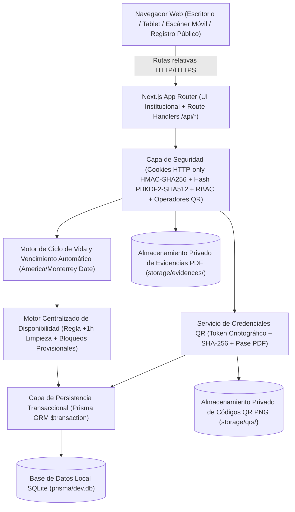

# Arquitectura del Sistema de Reservación de Espacios Universitarios (SREU) — Fase 1 y Fase 2

## 1. Visión General y Estilo Arquitectónico

El **Sistema de Reservación de Espacios Universitarios (SREU)** está diseñado bajo una arquitectura **Monolítica Modular Full-Stack** sobre **Next.js 14 (App Router)** con **TypeScript**, **Tailwind CSS**, **Prisma ORM** y **SQLite** local.

Tanto el frontend (interfaz institucional responsiva, registro público de asistentes y escáner móvil QR) como el backend (Route Handlers `/api/*`, motor transaccional de disponibilidad, motor de ciclo de vida y vencimiento automático, generador de credenciales QR, servicio SMTP opcional y servidor privado de documentos PDF y PNG) se ejecutan en un **único proceso y puerto (`3000`)**, facilitando su ejecución local y su exposición directa mediante **Ngrok** usando rutas relativas (`/api/...`).

---

## 2. Capas del Sistema

### 2.1 Capa de Presentación (UI/UX Institucional Responsiva)
- **Layout Protegido (`src/components/layout/AppShell.tsx`)**:
  - **Escritorio**: Barra lateral (`Sidebar`) con perfil activo, rol, edificio asociado y navegación filtrada por permisos (`Inicio`, `Mis eventos`, `Nuevo evento`, `Calendario`, `Autorizaciones`, `Escáner QR`, `Reportes`, `Administración`).
  - **Móvil y Tablet**: Barra inferior fija y acceso directo al módulo de escaneo QR (`/escaner`).
  - **Registro Público de Asistentes (`src/app/registro/[token]/page.tsx`)**: Ruta pública sin requerir cuenta institucional para eventos `OPEN`, con validación dinámica por tipo de asistente (`STUDENT`, `TEACHER`, `ADMIN_STAFF`, `EXTERNAL_GUEST`), aviso de privacidad y descarga inmediata de credencial QR en PNG y PDF.
  - **Módulo de Escaneo y Control de Acceso (`src/app/(protected)/escaner/page.tsx`)**: Interfaz optimizada para móviles y tablets con cámara en vivo (`BarcodeDetector` + fallback `jsQR`), carga de imagen PNG de QR, lector USB y pestaña de búsqueda manual de contingencia.

### 2.2 Motor de Ciclo de Vida de Eventos (`src/lib/lifecycle.ts`)
- Calcula el estado real del evento usando objetos `Date` reales en la zona horaria institucional (`America/Monterrey`), nunca comparando cadenas de texto.
- Distingue 7 estados generales del evento (`PENDING_APPROVAL`, `SCHEDULED`, `IN_PROGRESS`, `COMPLETED_PENDING_EVIDENCE`, `CLOSED`, `REJECTED`, `EXPIRED`) de forma independiente al estado de la solicitud de espacio, solicitud de equipo y estado del check-in.
- **Sincronización de Vencimientos (`syncExpiredRequests`)**:
  - Antes de listar o consultar eventos y autorizaciones, verifica si existen solicitudes `SpaceRequest` o `ScheduleChangeRequest` en estado `PENDING` cuya fecha/hora de inicio original ya llegó.
  - En una transacción Prisma, marca dichas solicitudes como `EXPIRED`, libera las reservaciones provisionales asociadas (`RELEASED`), preserva la reservación original aprobada cuando se trata de un cambio de horario vencido, envía notificación interna y registra `AuditLog`.
- **Bloqueo de Cambios tras Inicio del Evento**:
  - `hasEventStarted()` impide registrar o aprobar solicitudes de cambio de horario una vez que `fechaHoraActual >= fechaHoraInicio`.

### 2.3 Cierre Documental Obligatorio y Preservación de Evidencias PDF
- Los archivos PDF en `EventEvidence` se clasifican en:
  - `SUPPORTING_DOCUMENT`: Documentos previos o de soporte.
  - `CLOSURE_EVIDENCE`: Evidencia probatoria de realización y conclusión del evento.
- Para transicionar un evento a `CLOSED`, el backend verifica que el evento haya finalizado (`hasEventEnded`) y que exista al menos una evidencia activa (`isArchived = false`) de tipo `CLOSURE_EVIDENCE` subida después de la hora de término.
- **Prohibición de Eliminación Libre**: No existe borrado libre de evidencias. Cualquier reemplazo excepcional requiere rol `SUPER_ADMIN` y motivo obligatorio (`replacementReason`), conservando el archivo y registro anterior como `isArchived = true` y vinculándolo con el nuevo documento (`replacedById`).

### 2.4 Arquitectura de Credenciales QR y Privacidad (`src/lib/qr-service.ts`)
- **Cero Datos Personales en el QR**: El contenido codificado dentro del código QR es únicamente `SREU-QR:<rawToken>`, donde `rawToken` es un token aleatorio de alta entropía (`crypto.randomBytes(24)`). No contiene nombre, matrícula ni correo.
- **Almacenamiento Seguro**: En SQLite se almacena el `tokenHash` (`SHA-256`) como índice único para validación rápida en tiempo constante, mientras que el archivo gráfico PNG se guarda fuera de `/public` en `./storage/qrs/` y se sirve únicamente mediante `GET /api/qrs/[attendeeId]` validando sesión o token de descarga.
- **Control de Duplicados Transaccional**: La tabla `EventAttendance` tiene restricción `@unique` sobre `eventAttendeeId`. Al escanear un QR o registrar asistencia manual en `POST /api/events/[id]/check-in`, se ejecuta una transacción que verifica el estado del asistente, registra la asistencia única y escribe en la bitácora `AttendanceScanLog` (`SUCCESS`, `DUPLICATE`, `INVALID_TOKEN`, `WRONG_EVENT`, `REVOKED_CREDENTIAL`, `CHECKIN_CLOSED`).
